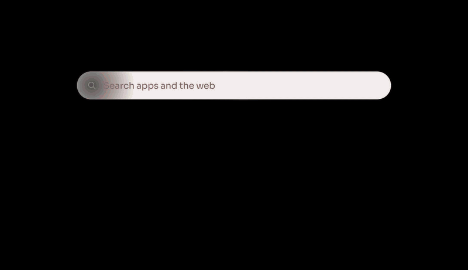
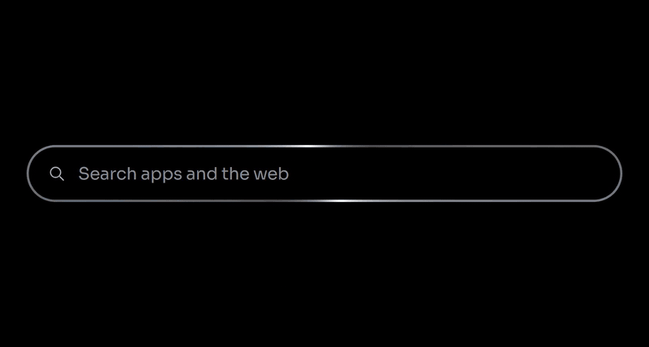

<h1 align="center">Omni</h1>

<p align="center">
  A fast, private launcher for Windows and Mac.<br>
  Press a hotkey, type, and open an app, ask a local AI, or find a file by what it <em>says</em>, not just what it is called.<br>
  Everything runs on your computer.
</p>

<p align="center">
  <a href="https://github.com/Adityuhh11/Omni/actions/workflows/ci.yml"></a>
  <a href="LICENSE"></a>
  <a href="https://github.com/Adityuhh11/Omni/releases/latest"></a>
</p>

<p align="center">
  <a href="#windows-11"><b>Install on Windows</b></a> ·
  <a href="#macos-13-apple-silicon"><b>Install on a Mac</b></a> ·
  <a href="docs/GUIDE.md"><b>User guide</b></a>
</p>

<table>
  <tr>
    <td width="50%"><br><sub>Find a photo by what it shows.</sub></td>
    <td width="50%"><br><sub>Ask a model that runs on your computer.</sub></td>
  </tr>
</table>

|  |  |
|---|---|
| **Instant** | The bar is painted about 33 ms after the hotkey (median) and never waits on a model. |
| **Light** | Idle, no CPU and about 270 MB including its web view. File search and AI are optional extras. |
| **Private** | No telemetry, no account. Your files and your index never leave the machine. The few network calls are [listed below](#privacy-and-the-network). |

> **Early (1.x).** Windows 11 and macOS 13+ on Apple Silicon; the Mac build is newer and has had less use. Expect rough edges, and please
> [open an issue](https://github.com/Adityuhh11/Omni/issues/new/choose) when you meet one. Linux is [planned](docs/ROADMAP.md).

## Try it

Press **Alt+Shift+Space** (Mac: **⌥⇧Space**), then type:

| Type | You get |
|---|---|
| `vsc` | Visual Studio Code, first in the list |
| `a pug wrapped in a blanket` | the photo, found by what it shows |
| `how I hash passwords` | the code file and the line |
| `5 km in miles` | the answer; Enter copies it |
| `ask: summarize my notes` | a chat with a model on this computer |
| `timer 25` | a small timer at the edge of the screen |

## What it does

- **Apps:** a few letters (`vsc`, `chr`) find them; the ones you use most rise to the top.
- **Files, by meaning** *(optional)*: code, PDF pages, notes, photos by what they show, videos, and what is said in audio.
- **Omni AI** *(optional)*: `ask:` chats with a model on your computer, or with LM Studio, Ollama or a service with your own key, using your files, notes,
  calendar and the web as tools you switch on.
- **Web and quicklinks:** `?` searches the web; `gh rust lifetimes` searches GitHub.
- **Clipboard history, snippets and notes.**
- **Focus, timers, calendar** (`join` opens the next meeting), **a calculator and conversions, and system commands** (`lock`, `sleep`, `restart`).

Every command, key and setting is in the [user guide](docs/GUIDE.md).

## Install

### Windows 11

1. Download `omni-<version>-windows-x64-setup.exe` from the [latest release](https://github.com/Adityuhh11/Omni/releases/latest) and run it. It installs
   for you alone (no administrator rights). Prefer no installer? The `.zip` holds the same `omni.exe`.
2. Windows may say **"Windows protected your PC"** because the program is not code-signed yet ([on the roadmap](docs/ROADMAP.md)). Click **More info**,
   then **Run anyway**. To check the file, compare its SHA-256 with the release page or run `gh attestation verify <file> --repo Adityuhh11/Omni`.
3. Press **Alt+Shift+Space**. Omni lives in the notification area by the clock, and the first start opens a short setup guide.

### macOS 13+ (Apple Silicon)

```sh
curl -fsSL https://github.com/Adityuhh11/Omni/releases/latest/download/install.sh | sh
```

It downloads `Omni.app`, checks it against the checksum GitHub published, and opens it. Press **⌥⇧Space** for the bar. Downloading the zip in a browser
instead, the permissions macOS asks for, updating and removing: [docs/INSTALL-MAC.md](docs/INSTALL-MAC.md).

**File search and Omni AI are off until you turn them on** in Settings. Each says what it will download (about 1 GB, every file checked against a pinned
SHA-256) before it does. A graphics card makes indexing fast; without one it still works, only more slowly. See [File search](docs/GUIDE.md#file-search).

## Performance

Measured on a laptop with an RTX 4050 (6 GB) and a real index of 46,000 chunks.

| | |
|---|---|
| Hotkey to a painted, focused input | **31 to 36 ms** median, under 50 ms p95 |
| App search, per keystroke | **0.2 ms** |
| File search query | **16 ms** median, 21 ms p95 |
| Idle | **0 % CPU**, about **270 MB**; file search adds about 450 MB and 1 GB of video memory |
| Search quality (92 hand-written queries) | right file first for 90 %, in the top three for 100 %, no false alarms |

## Privacy and the network

No telemetry. No account. Files are read only from folders you add, and secrets (`.env*`, keys and similar) are never opened. Omni goes online only
when you start something or switch it on: downloading the search engine or the AI model, a web search, a calendar you added, an AI service you chose,
or checking for updates. The engine and the model listen on `127.0.0.1` only.

<details>
<summary><b>Every network call, in full</b></summary>

<br>

| When | Where | What is sent |
|---|---|---|
| You press **Download and turn on** (or **Update**) in File search | `github.com`, `pypi.org`, `files.pythonhosted.org`, `huggingface.co` | ordinary downloads of pinned files |
| You press **Download and turn on** (or **Update**) in Omni AI | `github.com`, `huggingface.co` | ordinary downloads of pinned files (llama.cpp and the model); nothing you ask is ever sent anywhere |
| You open a web search or link | your browser | what you typed after the trigger |
| You switch on **Search the web** in the Omni AI chat's + menu (off by default) | `duckduckgo.com`, or `wikipedia.org` when DuckDuckGo asks for a check; then the pages the model chooses to read | the words the model chooses to search for (it composes them from your question and, after a read, from pages; it is a small model); then ordinary requests for pages that searches returned or that you wrote. Local and private addresses are refused |
| You choose **Another model** in Settings, Omni AI, and use it (off by default) | the address you typed: LM Studio or Ollama on this computer, or a service (OpenAI and others) | your questions and the conversation, and what the tools you switched on found for them. The API key, kept in the system credential store, goes as that service's `Authorization` header. The page says whether the address is on this computer |
| You switch on **Let AI apps on this computer use these tools** in Settings, Omni AI (off by default) | the AI app you connect (Claude Desktop, Cursor, VS Code…) | what that app asks Omni's tools that read (your files, notes, clipboard history, activity, calendars) and are switched on; the app may send it to its own servers |
| You add a calendar in Settings, Calendar | the address you added (Google, iCloud, Outlook…) | a request for the calendar, at once and every 15 minutes while Omni runs; the address is kept in the system credential store |
| You press **Check for updates**, or turned on the daily check (off by default) | `api.github.com` | a request for the latest release number, nothing about you |
| You press **Update to X** | `github.com` | a download of that release, checked against its published SHA-256 |

The engine and the Omni AI model server listen on `127.0.0.1` only, behind a random per-run token. Clipboard history is off by default and stored only on
your machine. Omni AI's tools (your files, notes, clipboard, activity, browser history and bookmarks, calendars, and your [scripts](docs/SCRIPTS.md)) run on this
computer and are off until you switch them on; with web search also on, the model could put what a tool found into the words it searches for.

</details>

## Go deeper

| | |
|---|---|
| [User guide](docs/GUIDE.md) | Every command and key, file search, `config.toml`, where Omni keeps its files, how it works |
| [Installing on a Mac](docs/INSTALL-MAC.md) | The browser download, macOS permissions, updating and removing |
| [Scripts](docs/SCRIPTS.md) | Turn your own scripts into commands and AI tools |
| [Roadmap](docs/ROADMAP.md) | What comes next, and what is not planned |
| [Architecture](docs/ARCHITECTURE.md) | Modules, data flow, on-disk format, invariants |
| [Contributing](CONTRIBUTING.md) | Building from source, the checks, how to send a change |

## Contributing

Bug reports, ideas and testing on hardware the maintainer does not have are welcome. Open an [issue](https://github.com/Adityuhh11/Omni/issues/new/choose)
first: pull requests are by invitation, once an issue says go. [`CONTRIBUTING.md`](CONTRIBUTING.md) has the setup, the build and the process; the code rules
are in [`AGENTS.md`](AGENTS.md). A vulnerability goes through [`SECURITY.md`](SECURITY.md), not a public issue.

## License

Omni is released under the [MIT License](LICENSE). The libraries it is built on, the programs its setup installs and the models it can download have their
own licenses; they are listed in [`THIRD_PARTY_NOTICES.md`](THIRD_PARTY_NOTICES.md).

| Model (downloaded on request, not part of Omni) | License |
|---|---|
| EmbeddingGemma 2, for file search | Apache License 2.0 |
| LFM3-1.7B by Liquid AI, for Omni AI | Liquid AI's LFM Open License ([terms](https://huggingface.co/LiquidAI/LFM3-1.7B-GGUF/blob/main/LICENSE)) |

## Acknowledgements

Omni stands on [llama.cpp](https://github.com/ggml-org/llama.cpp) (runs both models), [Wails](https://wails.io) (the desktop shell), [Svelte](https://svelte.dev),
[uv](https://github.com/astral-sh/uv), [SQLite](https://sqlite.org), [FastAPI](https://fastapi.tiangolo.com), [PDFium](https://pdfium.googlesource.com/pdfium/) through
[pypdfium2](https://github.com/pypdfium2-team/pypdfium2), [PyAV](https://github.com/PyAV-Org/PyAV), and the Geist and Sora typefaces.
Thanks to the people who built them, and to Google and Liquid AI for releasing their models.
